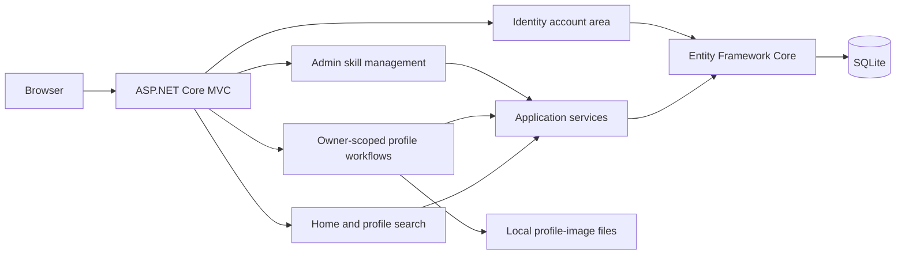

# MVS Skills

An ASP.NET Core MVC skill-sharing prototype. Users can create professional profiles, search profiles by name, profession, and skill, manage their own profile, upload profile images, and rate other profiles.

> **Local branch only:** this work is not published. The existing public Git history contains database, profile, and image artifacts whose provenance has not been established. Review and remediate that history before publishing any branch or promoting the repository.

## Demonstration

The screenshot below was captured from the running application using an isolated SQLite database and a synthetic profile. It contains no data from the checked-in database.


## Features

- Search profiles by name, profession, and selected skills.
- Register and sign in with ASP.NET Identity.
- Create and manage profiles under the authenticated owner.
- Upload profile images with file-count, size, extension, and signature checks.
- Select an uploaded image as the profile avatar.
- Rate another user's profile from 1 to 5.
- Manage skills through admin-authorized MVC actions.

## Technology

- C# and ASP.NET Core MVC
- Entity Framework Core 9 with SQLite
- ASP.NET Core Identity
- Razor views and Bootstrap

## Architecture



## Requirements

- .NET 8 SDK
- The `dotnet-ef` tool at version 9.0.2 for applying the checked-in EF migrations

Install the EF command-line tool if needed:

```powershell
dotnet tool install --global dotnet-ef --version 9.0.2
```

## Run with an isolated local database

Run these commands from the repository root. The database is placed in the user's temporary directory, outside the repository.

```powershell
dotnet restore MVC/MVC.csproj
dotnet build MVC/MVC.csproj --no-restore

$demoDb = Join-Path $env:TEMP 'mvs-skills-demo.sqlite'
$env:ConnectionStrings__DefaultConnection = "Data Source=$demoDb"

Set-Location MVC
dotnet ef database update --no-build --project MVC.csproj --startup-project MVC.csproj
dotnet run --no-build --no-launch-profile --project MVC.csproj --urls http://127.0.0.1:5179
```

Open `http://127.0.0.1:5179/`. Register a local account, then use the **User Info** area to create a profile. All sample profiles should be synthetic. Stop the app with `Ctrl+C` and clear the temporary database when finished.

## Verification

`dotnet build MVC/MVC.csproj --no-restore` passed after the local changes. Manual HTTP scenarios against the isolated database verified registration and login, lockout after repeated failed sign-ins, antiforgery enforcement, profile creation and owner edits, cross-owner edit/delete rejection, rating bounds, and rejection of a text file renamed with an image extension. Anonymous profile search was reproduced as HTTP 500, fixed, and then verified as HTTP 200 with the synthetic profile.

There is no committed automated test project. The runtime checks do not constitute a full security audit or image decoder test.

## Limitations and security status

- The application is an academic prototype; no production deployment or external hosting has been verified.
- The application uses local SQLite persistence and local image files. A deployment needs explicit database, upload storage, backup, and access-control operations.
- Image uploads are checked against allowed extensions and file signatures, but the app does not fully decode images or enforce a persistent per-user storage quota.
- Existing public Git history requires a data-provenance review. This branch remains local and must not be pushed until that issue is resolved and the history is safely remediated.
