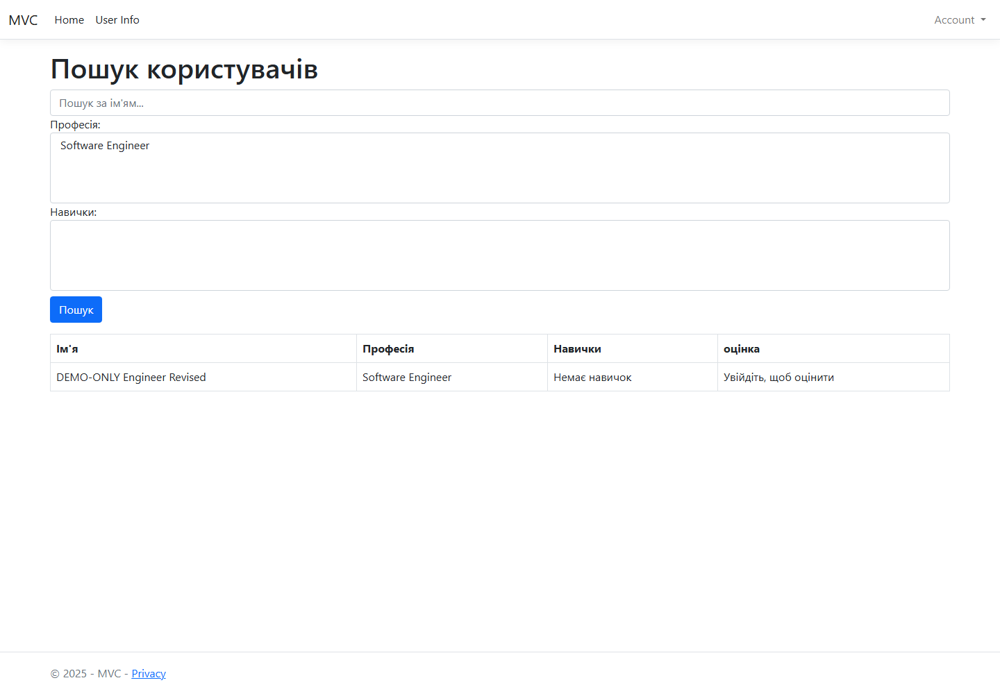

# MVS Skills

MVS Skills is an academic ASP.NET Core MVC skill-sharing prototype. Users can create professional profiles, search by name, profession, and skill, manage their own profiles, upload profile images, and rate other profiles.

> **Data provenance:** The existing repository history contains a tracked SQLite database and profile or image artifacts whose provenance has not been established. This change adds source code and a synthetic-only screenshot; it does not add records from that database. Do not reuse historical data as demo data until its provenance is reviewed.

## Demonstration

The screenshot was captured from the running application with an isolated SQLite database and a synthetic profile.

## Features

- Search profiles by name, profession, and selected skills.
- Register and sign in with ASP.NET Identity.
- Create and manage profiles under the authenticated owner.
- Upload profile images with file-count, size, extension, and signature checks.
- Select an uploaded image as the profile avatar.
- Rate another user's profile from 1 to 5.
- Manage skills through admin-authorized MVC actions.

## Technology

- C# and ASP.NET Core MVC
- Entity Framework Core 9 with SQLite
- ASP.NET Core Identity
- Razor views and Bootstrap

## Project documentation

- [Development setup](docs/DEVELOPMENT.md): isolated database setup, migrations, and troubleshooting.
- [Project overview](docs/PROJECT_OVERVIEW.md): main user journeys, application areas, and data flow.

## Run locally with an isolated database

Requirements: .NET 8 SDK and the dotnet-ef tool at version 9.0.2.

Install the EF command-line tool if needed:

~~~powershell
dotnet tool install --global dotnet-ef --version 9.0.2
~~~

Run from the repository root. The database is stored in the temporary directory outside the repository.

~~~powershell
dotnet restore MVC/MVC.csproj
dotnet build MVC/MVC.csproj --no-restore

$demoDb = Join-Path $env:TEMP 'mvs-skills-demo.sqlite'
$env:ConnectionStrings__DefaultConnection = "Data Source=$demoDb"

Set-Location MVC
dotnet ef database update --no-build --project MVC.csproj --startup-project MVC.csproj
dotnet run --no-build --no-launch-profile --project MVC.csproj --urls http://127.0.0.1:5179
~~~

Open http://127.0.0.1:5179/ and register a local account. Use the User Info area to create a synthetic profile. Stop the app with Ctrl+C and remove the temporary database when finished.

## Verification

The MVC project built successfully after the source changes. Manual HTTP scenarios against the isolated database verified registration and login, lockout after repeated failed sign-ins, antiforgery enforcement, profile creation and owner edits, rejection of cross-owner edits and deletes, rating bounds, and rejection of a text file renamed with an image extension. Anonymous profile search was reproduced as HTTP 500, fixed, and verified as HTTP 200 with the synthetic profile.

There is no committed automated test project. These runtime checks are not a full security audit or image-decoder test.

## Limitations

- This is an academic prototype; production deployment and external hosting have not been verified.
- The application uses local SQLite persistence and local image files. A deployment needs an explicit plan for database and upload storage, backups, access control, and operations.
- Uploads are checked against allowed extensions and file signatures, but images are not fully decoded and persistent per-user storage quotas are not enforced.
- The existing public Git history still needs a data-provenance review. This source update does not remove or rewrite historical records.