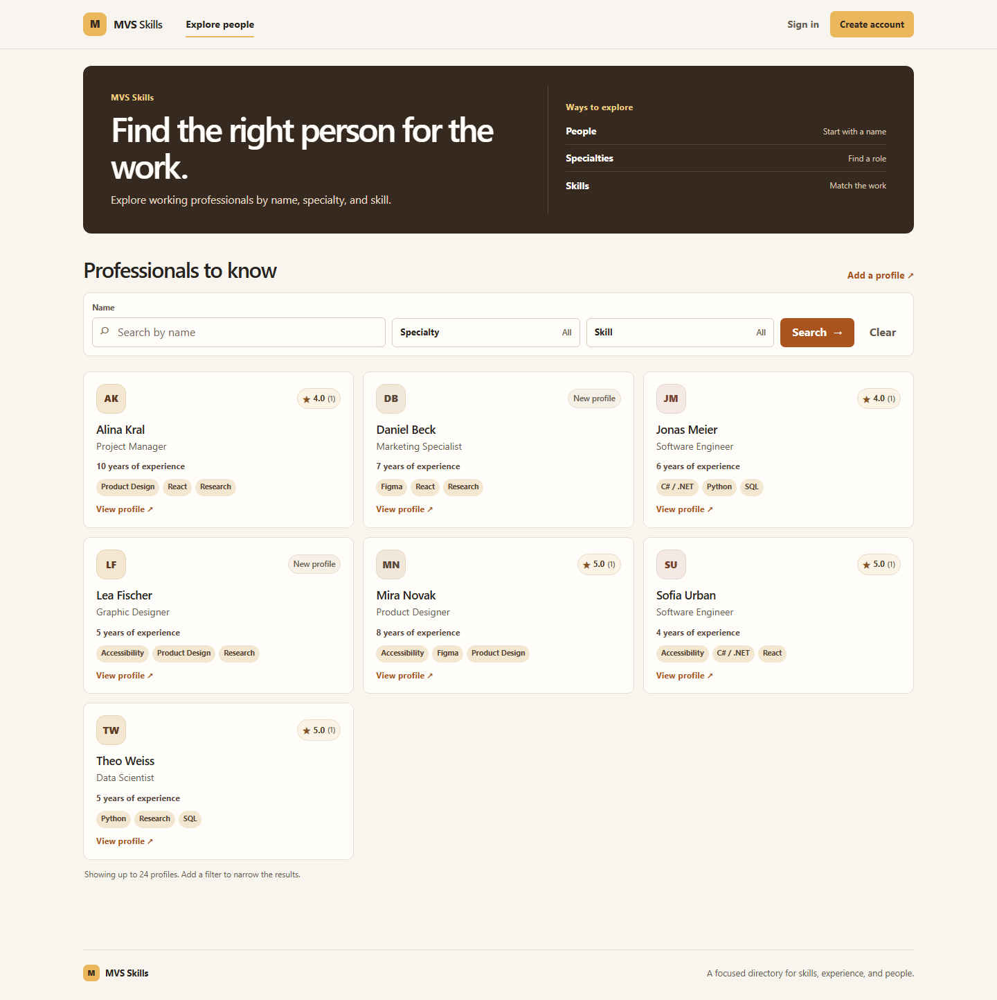
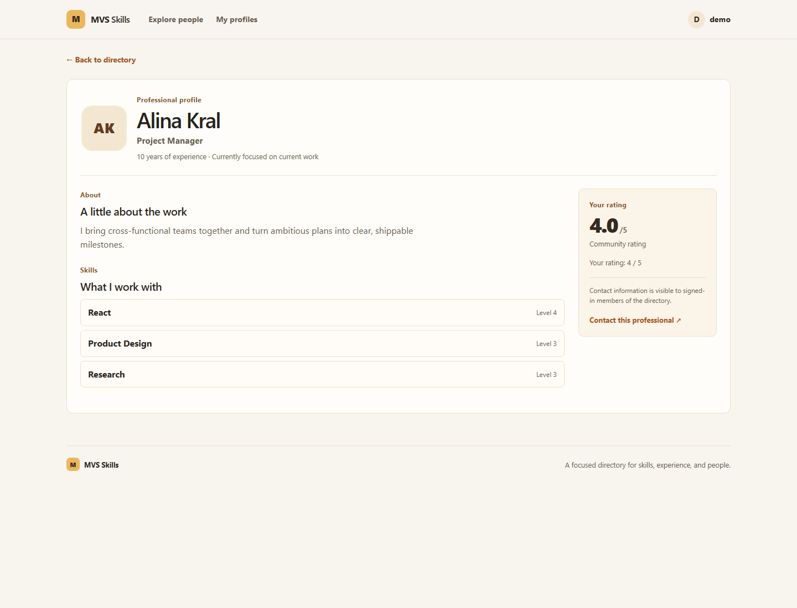
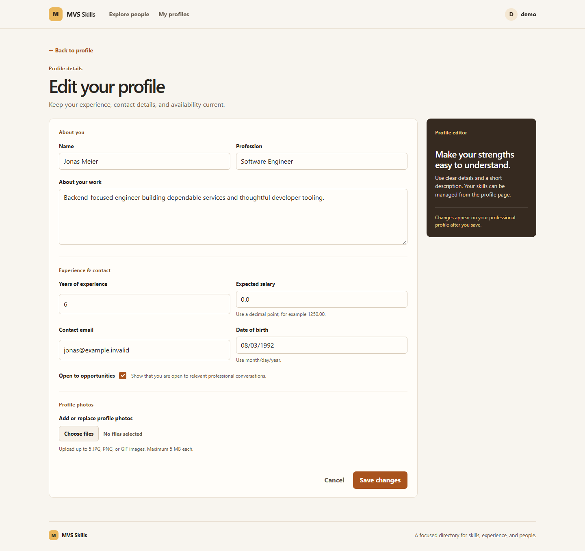

# MVS Skills

MVS Skills is an academic ASP.NET Core MVC skill-sharing prototype. Users can create professional profiles, search by name, profession, and skill, manage their own profiles, upload profile images, and rate other profiles.

> **Demo data:** The owner confirms that users, profiles, and SQLite/JSON records in this academic project were generated randomly for testing and contain no real personal data. This update removes runtime databases, profile JSON, and uploaded images from the current Git index while preserving local copies. Git history is not rewritten.

## Interface preview

These screenshots show the running MVC application with synthetic profiles and an isolated SQLite database. No historical repository database or user-uploaded image was used.

### Professional discovery

### Profile and account flows

## Features

- Search profiles by name, profession, and selected skills.
- Register and sign in with ASP.NET Identity.
- Create and manage profiles under the authenticated owner.
- Upload profile gallery photos and skill logos with file-count, size, extension, and signature checks.
- Select an uploaded image as the profile avatar.
- Rate another user's profile from 1 to 5.
- Manage skills through admin-authorized MVC actions.

## Technology

- C# and ASP.NET Core MVC
- Entity Framework Core 9 with SQLite
- ASP.NET Core Identity
- Razor views and Bootstrap

## Project documentation

- [Development setup](docs/DEVELOPMENT.md): isolated database setup, migrations, and troubleshooting.
- [Project overview](docs/PROJECT_OVERVIEW.md): main user journeys, application areas, and data flow.

## Run locally with an isolated database

Requirements: .NET 8 SDK and the dotnet-ef tool at version 9.0.2.

Install the EF command-line tool if needed:

~~~powershell
dotnet tool install --global dotnet-ef --version 9.0.2
~~~

Run from the repository root. The database is stored in the temporary directory outside the repository.

~~~powershell
dotnet restore MVC/MVC.csproj
dotnet build MVC/MVC.csproj --no-restore

$demoDb = Join-Path $env:TEMP 'mvs-skills-demo.sqlite'
$env:ConnectionStrings__DefaultConnection = "Data Source=$demoDb"

Set-Location MVC
dotnet ef database update --no-build --project MVC.csproj --startup-project MVC.csproj
dotnet run --no-build --no-launch-profile --project MVC.csproj --urls http://127.0.0.1:5179
~~~

Open http://127.0.0.1:5179/ and register a local account. Use the User Info area to create a synthetic profile. Stop the app with Ctrl+C and remove the temporary database when finished.

## Verification

The MVC project built successfully after the source changes. Browser review covered discovery, profile details, registration, and profile editing at 360, 390, 768, 1024, and 1440 px with no horizontal overflow. Search was exercised against synthetic profiles. Manual HTTP scenarios against the isolated database verified registration and login, lockout after repeated failed sign-ins, antiforgery enforcement, profile creation and owner edits, rejection of cross-owner edits and deletes, rating bounds, and rejection of a text file renamed with an image extension. Anonymous profile search was reproduced as HTTP 500, fixed, and verified as HTTP 200 with the synthetic profile.

There is no committed automated test project. These runtime checks are not a full security audit or image-decoder test.

## Limitations

- This is an academic prototype; production deployment and external hosting have not been verified.
- ASP.NET Identity requires passwords to be at least 15 characters long, without mandatory digit/case/symbol composition. Account and email confirmation are disabled; no production email delivery or recovery workflow is configured.
- The application uses local SQLite persistence and local image files. A deployment needs an explicit plan for database and upload storage, backups, access control, and operations.
- Profile-gallery and skill-logo uploads have size and signature checks but are not fully decoded. Account-avatar uploads currently check only the filename extension and lack an application-level size limit or storage quota; account deletion also leaves uploaded avatar files behind. Address this before exposing the prototype to untrusted users.
- The owner confirms that historical user, profile, SQLite, and JSON records were randomly generated test data with no real personal information. Older revisions remain in Git history; the current index excludes runtime databases, profile JSON, and uploaded images. Git history was not rewritten.
