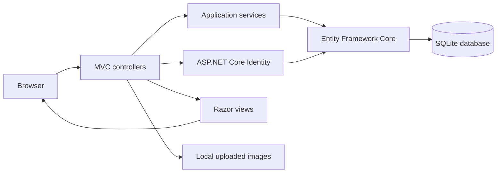

# Project Overview

## Main user journeys

1. Visitors search the profile list by name, profession, or selected skills.
2. A person registers, signs in, and creates or edits a professional profile with contact and experience details, skills, and photos.
3. Signed-in users can choose a 1–5 rating for another profile. Self-ratings and repeat ratings for the same profile are blocked.
4. Administrators use the account-management area and the skill-management screens.

## Application areas

| Area | Location | Responsibility |
| --- | --- | --- |
| Public search | `MVC/Controllers/HomeController.cs` and `MVC/Views/Home/` | Profile search and result rendering. |
| Profiles | `MVC/Controllers/UserInfoController.cs` and `MVC/Views/UserInfo/` | Profile details, photos, skills, and ratings. |
| Skills | `MVC/Controllers/SkillController.cs` and `MVC/Views/Skill/` | Admin-only skill management. |
| Accounts | `MVC/Areas/Auth/` | Registration, sign-in, account profile, and admin account screens. |
| Persistence | `MVC/Models/`, `MVC/Models/Services/`, and `MVC/Migrations/` | Entity models, application services, and SQLite schema migrations. |

## Request and data flow

## Local data

The default connection string points to `MVC/site.db`. For development, use the isolated temporary database described in [Development Setup](DEVELOPMENT.md). Uploaded images are stored under the web project's `wwwroot/images/` directory. Use synthetic data and do not treat local database or image files as a production storage strategy.
